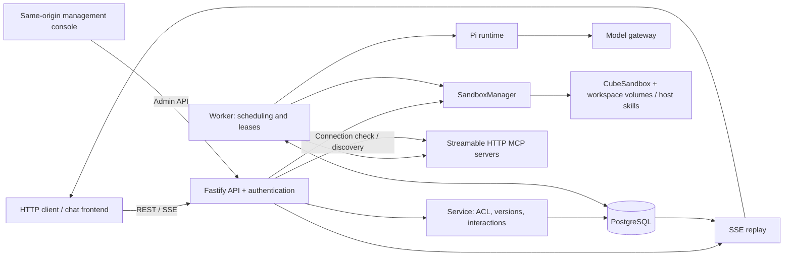
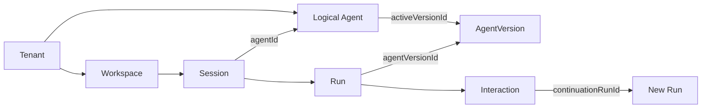

# Pi-Flow architecture

[简体中文](architecture.zh-CN.md) · [README](../README.md)

This document describes the current implementation on `main`. Detailed regression history lives in [implementation.md](implementation.md); production evidence and release gates live in [acceptance.md](acceptance.md).

## Components and processes



Production normally runs API and Worker as separate processes sharing one database and deployment policies. The API serves the management console without a separate frontend process. Demo runs an inline Worker with a simulated runtime and in-memory Sandbox provider; setting `DATABASE_URL` persists Demo metadata in PostgreSQL, while simulated files remain in memory. `INLINE_WORKER=true` also enables an inline Worker in production.

| Module | Responsibility |
| --- | --- |
| `src/api.ts`, `src/auth.ts` | REST/SSE, input validation, UCS OIDC, request audit |
| `src/agent-admin-ui.ts` | Same-origin management page, admin API client, drafts and conflict handling |
| `src/domain.ts`, `src/service.ts` | ACL, immutable agent versions, idempotency, interactions |
| `src/store.ts`, `src/run-store.ts` | Metadata transactions, sessions, Runs, events, read projections |
| `src/worker.ts` | Tenant scheduling, claims, heartbeats, cancellation, tool policy, child tasks |
| `src/runtime.ts` | Pi sessions, controlled resource loading, model invocation |
| `src/adapters/sandbox.ts`, `src/sandbox/*` | Sandbox orchestration, providers, leases, bounded remote calls |
| `src/adapters/sandbox-policy.ts`, `src/capacity-store.ts` | Shared capacity reservations and operation fencing |
| `src/adapters/skill-mounts.ts` | Skill mount identity, volume/host source validation, and logical scope |
| `src/adapters/mcp.ts` | MCP discovery, allowlists, credentials, bounded calls |
| `src/usage.ts`, `src/telemetry.ts`, `src/health.ts` | Budget ledger, cost estimates, telemetry, health |

See [Sandbox module boundaries](sandbox-modules.md) for the provider/manager split.

## Data and storage

A Tenant owns its agents, workspaces, sessions, Runs, and audit/usage records. A Workspace owns files and owner/editor/viewer membership; a Session holds conversation history and follows a stable logical Agent; a Run represents one execution with a pinned immutable AgentVersion and capability snapshot.



A logical Agent can own multiple immutable versions; `activeVersionId` selects the version for new independent tasks. Interaction continuations and child tasks have their own Run IDs but share the root task's `taskId` and `rootRunId`; child tasks also have separate Sessions. The new Run in the diagram is another execution record, not a separate resource type.

PostgreSQL persists sessions, Runs, event logs, and event cursors in `harness_sessions`, `harness_runs`, `harness_run_events`, and `harness_event_sequences`. Capacity records use `harness_sandbox_leases`. Tenant metadata and the usage ledger still use JSONB aggregates; the previous all-in-one Run/capacity aggregates are not the active storage design.

The database owns execution and governance state; Cube workspace volumes own research or business files. Instance snapshots do not back up the database or workspace volumes. Deployment configuration selects skill sources, which mount as read-only resources.

## Execution and interaction

```text
POST message → QUEUED → Worker claim → RUNNING
                                        ├─ COMPLETED / FAILED / CANCELLED
                                        └─ WAITING_INPUT
                                             └─ User response → new QUEUED Run
```

The Worker selects tenants in round-robin order, loads authorized execution context, and invokes Pi with an explicit tool set. Completed messages and session checkpoints persist to the database. Approval records validated tool arguments; the continuation rechecks authorization before executing the approved operation. Rejecting an action skips its execution.

Child agents have separate sessions, intersect parent/child permissions, and share root task budgets. Execution is sequential; a child requiring approval or an answer fails safely and returns to its parent.

Expired Worker ownership ends an uncertain Run as `FAILED`, rather than requeueing it. Unknown remote side effects are not automatically retried or replayed. Cancellation propagates to the runtime and remote operations; unconfirmed cleanup remains an explicit error and retains capacity.

### Scheduling and concurrency

- Session partial uniqueness prevents overlapping `QUEUED`, `RUNNING`, or `WAITING_INPUT` Runs. Idempotency is scoped to Tenant + User + Session + Key.
- Run claims, heartbeats, and completion check persistent lease ownership and expiry. Ordinary cross-entity writes retain a tenant metadata lock.
- Capacity admission uses a global transaction advisory lock and indexed counts. `reserved` and `unknown` outcomes remain charged; transitions compare their persistent operation identifier.
- If authorization fails after capacity reservation, an untouched instance reservation with no in-flight creation restores its prior accounting state (or becomes `released` for a new workspace). Rollback retains the new operation identifier to fence old callbacks and cannot overwrite a successor. Confirmed volume creation alone does not retain a Sandbox slot. Once instance operations have started, authorization failure before activation uses confirmed cleanup; uncertain outcomes remain `unknown` and charged.
- Different sessions can infer concurrently. Concurrent agent tools (including read-only `read`, `ls`, `grep`, and `find`) transparently wait for the persistent workspace lease and execute exclusively. Waiters observe workspace/skill metadata using non-locking reads that do not load Runs, Sessions or event history. Only a potentially available lease triggers a write transaction, which rechecks the lock and authorization atomically across Runs and Worker processes sharing PostgreSQL; FIFO ordering is not guaranteed. Mutating tools (`write`, `edit`, `bash`) recheck workspace write permission, and Worker calls revalidate current Run ownership, deadline and authorization before acquisition and dispatch. Waiting responds to Run cancellation/deadlines and is bounded to 130 seconds by default; expiration returns `WORKSPACE_QUEUE_TIMEOUT`. Waiting does not reserve capacity or touch the active sandbox. Active lifecycle or file-write locks still return `WORKSPACE_BUSY`, and lifecycle operations/file writes still reject an active agent lease. File reads use a separate temporary instance and can run alongside agent tools.

These constraints preserve correctness and still create contention boundaries. See [Run migration](run-migration.md), [capacity migration](capacity-migration.md), and [usage budgets](usage-budgets.md).

## Versions and access

### Logical identity and execution versions

A Session records `agentId` and its most recently effective `effectiveVersionId` (`agentVersionId` remains a compatibility alias). A new independent root task resolves `activeVersionId` within the submission transaction, validates capabilities and Workspace compatibility, and updates the Session's effective version. Every Run pins `agentVersionId`, capabilities, `taskId`, and `rootRunId`; continuations and delegated Runs inherit task identity without using the Session's mutable effective version for execution. Subagents reference immutable version IDs and intersect capabilities with the parent.

### Publication, activation, and task chains

Publication updates only the logical Agent activeVersionId, without scanning Sessions or disabling previous versions. Accepted queued Runs, running tasks and waiting continuations keep their pinned versions. New roots upgrade lazily while preserving history, Todo and Workspace Volume; idempotent retries return the original Run. Unfinished descendants keep the root Session busy. Upgrade events and audits record from/to, time, actor and reason. Emergency revocation remains dynamic through version status/access, Skill/MCP state and tenant grants.

### Dynamic access and revocation

The logical Agent owns allowedUsers. Publication and rollback change execution versions without changing ACL; historical queries and old-task execution use the same live policy.

Root admission invalidates revoked waiting tasks that have released checkpoint leases, recording failed task members and audit reasons. Token expiry alone allows subject refresh. Historical Skill identity is independent of live authorization, while compatible admission still respects valid waiting tasks and active leases. Cancellation uses taskId to stop the entire task chain, including continuations of completed Runs; active execution keeps the existing safe stop and lease cleanup behavior.

### Workspace and skill compatibility

Sandbox pause/release never upgrades a Session. Same bundle and scope reuse the Sandbox; a changed scope rebuilds under the exclusive Workspace tool lease while preserving the Volume. Released Sandboxes are created using the pinned configuration. Incompatible unfinished tasks sharing a Workspace yield WORKSPACE_VERSION_BUSY; retry when they finish. Tool/lifecycle lease conflicts yield WORKSPACE_BUSY. Cross-bundle upgrades yield WORKSPACE_BUNDLE_MIGRATION_REQUIRED: automatic Volume bundle migration is unsupported; create a Workspace for that bundle.

Workspace records logical Skill identity separately from the provider scope that includes physical Volume/Host mount bindings: admission compares logical scopes, and tool leases still validate physical scopes. Explicit Resume is a lifecycle operation; if any stored Skill was revoked, it restores a skill-free environment while preserving the Volume and Session version. The next task adapts its environment using its pinned configuration; waiting tasks remain subject to dynamic revocation.

See the [version migration guide](agent-version-migration.md) for migration 005/006 backfills, legacy ACL handling, and rollback. Stop old writers and back up before upgrading.

## Management console and configuration

The same-origin management console opens at `/admin/ui`, which redirects to `/admin/agents/ui`. Its HTML shell is public; management APIs require an administrator and scope data to the authenticated Tenant. Production normally uses a UCS JWT with the `harness-admin` role; Demo uses `DEV_TOKEN`, and isolated deployments can explicitly configure a fixed-token identity. Tokens stay in page memory; disconnect aborts pending requests and clears page data.

Configuration has three layers:

| Layer | Ownership and effect |
| --- | --- |
| Deployment settings | Server environment configuration supplies model credentials, skill sources, MCP endpoints, tenant grants, and Sandbox policy; the console displays non-sensitive capabilities read-only, and changes require restarting the relevant API/Workers |
| Tenant draft defaults | Tenant metadata stores `agentDefaults` and `defaultsRevision`, used only to initialize new agent drafts; they do not change published versions or existing Sessions |
| AgentVersion | Administrators submit complete configuration to publish an immutable execution version; the logical Agent's active pointer selects the version for new independent tasks |

Saving defaults requires `expectedRevision`, checked and incremented within a server transaction; a stale write returns `409 DEFAULTS_CONFLICT`. The client retains its draft for an explicit reload or retry with the latest revision. Defaults persist through the Store: production uses PostgreSQL, while an in-memory Demo resets on restart.

Skill and MCP registration select resources already deployed and granted server-side. An MCP connection check discovers allowlisted tools without executing them; it calls the configured endpoint from the API process using server credentials and does not return secrets or endpoint URLs. See the [management console guide](admin-console.md) for operations and [API](api.md#管理控制台) for endpoints and payloads.

## Events and clients

Worker events are durable before SSE delivery. Message deltas are batched; replay uses indexed pages of at most 100 events, PostgreSQL notifications, and bounded polling. Notifications wake readers; the event log is the replay source. Clients reconnect using the last received event ID.

SSE ends at a terminal state or `WAITING_INPUT`. A response to an interaction returns a new Run ID. Token expiry closes the stream with `AUTHENTICATION_EXPIRED`; reconnect requires a fresh authorization header. Read pages recheck workspace ACL. See [event streaming](event-streaming.md) and [API](api.md).

## Sandbox, skills, and MCP

Pi's resource loader disables automatic local skill/extension discovery and default local file/shell tools. The Worker exposes remote tools and build-time interaction tools. Production file and shell execution happens inside CubeSandbox; UCS, model, and MCP credentials are not injected into that Sandbox.

### Workspace and skill sources

Each workspace mounts its own writable `/workspace` volume. `SKILL_VOLUMES_JSON` maps a skill version to its manifest path and exactly one source: a `hostPath` directory by default, or an explicitly configured `volume`. Both backends mount read-only at the directory containing the registered `/skills/.../SKILL.md`. Bundle names are tenant authorization groups, not mounted volume names. Tool access verifies manifest identity and SHA-256. A change to the authorized skill set or physical mount scope rebuilds the instance after confirming the previous instance is killed, retaining the workspace volume.

| Source | Constraints |
| --- | --- |
| Volume | Each skill version uses an independent volume, distinct from the workspace volume |
| Host | `SKILL_HOST_ROOTS_JSON` defaults to `["/data/agent-skills"]`; an explicit list replaces it, and `[]` disables host sources. Sources must be strict descendants of approved canonical absolute roots, without overlapping sources, symlinks, or special files |

Host mode requires **the same filesystem at the same canonical absolute path** on every API/Worker and eligible Cubelet node. Remote nodes need shared storage; a copy of the files does not satisfy this requirement. Unavailable or unverifiable sources are rejected by control processes. CubeMaster must also allow the host directories. API requests cannot select sources or mount destinations. See [host skill deployment](deployment.md#local-host-skills--cubelet-宿主机技能目录).

### Capacity and instances

File API requests use temporary instances with only the workspace volume. They consume owner/global capacity and require confirmed cleanup. Default policy permits three active instances per workspace owner within a tenant and 100 across the deployment; idle instances pause after 15 minutes and release after 24 hours, with Worker scans every minute.

### MCP and credentials

MCP discovery visits only the agent's configured servers. Calls recheck allowlists, endpoint identity, and revocation. Discovery inherits cancellation and the remaining Run deadline, with a 30-second overall ceiling. Deployment credentials authenticate service access; delegated user OAuth is pending.

### Cube isolation and snapshots

Cube enforces the actual non-root identity, volume isolation, resource limits, and network policy. An inbound traffic setting does not establish outbound isolation. Instance snapshots retain current workspace files when restored and are not volume/database backups; cross-workspace Cube clones are rejected.

## Operations and limits

API readiness checks database/schema availability separately from Worker health. All API/Worker processes must use consistent grants, model settings, volumes, capacity policy, and pricing. Stop old writers and back up before migrations; mixed old/new storage writers are unsupported.

Local and protocol tests do not establish enterprise Cube isolation, provider billing accuracy, or production capacity. Cost reports are estimates using recorded usage and price snapshots. History retention and remaining JSONB growth need deployment policy. See [deployment](deployment.md), [health](health.md), [observability](observability.md), and [acceptance](acceptance.md).
