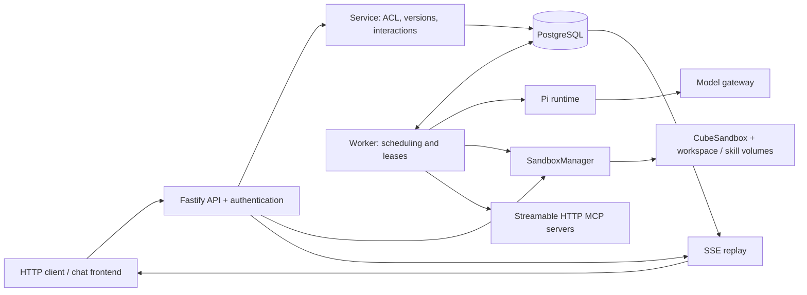

# Pi-Flow architecture

[简体中文](architecture.zh-CN.md) · [README](../README.md)

This document describes the current `work` branch. Detailed regression history lives in [implementation.md](implementation.md); production evidence and release gates live in [acceptance.md](acceptance.md).

## Components



Production normally runs API and Worker as separate processes sharing one database. Demo runs an inline Worker with a simulated runtime and in-memory Sandbox provider. `INLINE_WORKER=true` also enables an inline Worker in production.

| Module | Responsibility |
| --- | --- |
| `src/api.ts`, `src/auth.ts` | REST/SSE, input validation, UCS OIDC, request audit |
| `src/domain.ts`, `src/service.ts` | ACL, immutable agent versions, idempotency, interactions |
| `src/store.ts`, `src/run-store.ts` | Metadata transactions, sessions, Runs, events, read projections |
| `src/worker.ts` | Tenant scheduling, claims, heartbeats, cancellation, tool policy, child tasks |
| `src/runtime.ts` | Pi sessions, controlled resource loading, model invocation |
| `src/adapters/sandbox.ts`, `src/sandbox/*` | Sandbox orchestration, providers, leases, bounded remote calls |
| `src/adapters/sandbox-policy.ts`, `src/capacity-store.ts` | Shared capacity reservations and operation fencing |
| `src/adapters/mcp.ts` | MCP discovery, allowlists, credentials, bounded calls |
| `src/usage.ts`, `src/telemetry.ts`, `src/health.ts` | Budget ledger, cost estimates, telemetry, health |

See [Sandbox module boundaries](sandbox-modules.md) for the provider/manager split.

## Data and concurrency

A Tenant owns its agents, workspaces, sessions, Runs, and audit/usage records. Workspace access is controlled by owner/editor/viewer roles. A Session pins an immutable AgentVersion; a Run represents one execution or interaction continuation.

PostgreSQL persists sessions, Runs, event logs, and event cursors in `harness_sessions`, `harness_runs`, `harness_run_events`, and `harness_event_sequences`. Capacity records use `harness_sandbox_leases`. Tenant metadata and the usage ledger still use JSONB aggregates; the previous all-in-one Run/capacity aggregates are not the active storage design.

- Session partial uniqueness prevents overlapping `QUEUED`, `RUNNING`, or `WAITING_INPUT` Runs. Idempotency is scoped to Tenant + User + Session + Key.
- Run claims, heartbeats, and completion check persistent lease ownership and expiry. Ordinary cross-entity writes retain a tenant metadata lock.
- Capacity admission uses a global transaction advisory lock and indexed counts. `reserved` and `unknown` outcomes remain charged; transitions compare their persistent operation identifier.
- Different sessions can infer concurrently. Concurrent agent tools (including read-only `read`, `ls`, `grep`, and `find`) transparently wait for the persistent workspace lease and execute exclusively. Acquisition is retried in transactions, so serialization also applies across Runs and Worker processes sharing PostgreSQL; FIFO ordering is not guaranteed. Waiting responds to Run cancellation/deadlines and is bounded to 130 seconds by default (`WORKSPACE_QUEUE_TIMEOUT`); it does not reserve capacity or touch the active sandbox. Authorization is rechecked on each attempt. Active lifecycle or file-write locks still return `WORKSPACE_BUSY`, and lifecycle operations/file writes still reject an active agent lease. File reads use a separate temporary instance and can run alongside agent tools.

These constraints preserve correctness and still create contention boundaries. See [Run migration](run-migration.md), [capacity migration](capacity-migration.md), and [usage budgets](usage-budgets.md).

## Execution and interaction

```text
POST message → QUEUED → Worker claim → RUNNING
                                        ├─ COMPLETED / FAILED / CANCELLED
                                        └─ WAITING_INPUT
                                             └─ User response → new QUEUED Run
```

The Worker selects tenants in round-robin order, loads authorized execution context, and invokes Pi with an explicit tool set. Completed messages and session checkpoints persist to the database. Approval records validated tool arguments; the continuation rechecks authorization before executing the approved operation. Rejecting an action skips its execution.

Child agents have separate sessions, intersect parent/child permissions, and share root task budgets. Execution is sequential; a child requiring approval or an answer fails safely and returns to its parent.

Expired Worker ownership ends an uncertain Run as `FAILED`, rather than requeueing it. Unknown remote side effects are not automatically retried or replayed. Cancellation propagates to the runtime and remote operations; unconfirmed cleanup remains an explicit error and retains capacity.

## Events and clients

Worker events are durable before SSE delivery. Message deltas are batched; replay uses indexed pages of at most 100 events, PostgreSQL notifications, and bounded polling. Notifications wake readers; the event log is the replay source. Clients reconnect using the last received event ID.

SSE ends at a terminal state or `WAITING_INPUT`. A response to an interaction returns a new Run ID. Token expiry closes the stream with `AUTHENTICATION_EXPIRED`; reconnect requires a fresh authorization header. Read pages recheck workspace ACL. See [event streaming](event-streaming.md) and [API](api.md).

## Execution and security boundaries

Pi's resource loader disables automatic local skill/extension discovery and default local file/shell tools. The Worker exposes remote tools and build-time interaction tools. Production file and shell execution happens inside CubeSandbox; UCS, model, and MCP credentials are not injected into that Sandbox.

Each workspace mounts its own writable `/workspace` volume. `SKILL_VOLUMES_JSON` maps each selected skill version to an independent read-only volume and manifest path. Bundle names are tenant authorization groups. Tool access verifies manifest identity and SHA-256. Changing the authorized skill set rebuilds the instance after confirming the previous instance is killed, retaining the workspace volume.

File API requests use temporary instances with only the workspace volume. They consume owner/global capacity and require confirmed cleanup. Default policy permits three active instances per workspace owner within a tenant and 100 across the deployment; idle instances pause after 15 minutes and release after 24 hours, with Worker scans every minute.

MCP discovery visits only the agent's configured servers. Calls recheck allowlists, endpoint identity, and revocation. Discovery inherits cancellation and the remaining Run deadline, with a 30-second overall ceiling. Deployment credentials authenticate service access; delegated user OAuth is pending.

Cube enforces the actual non-root identity, volume isolation, resource limits, and network policy. An inbound traffic setting does not establish outbound isolation. Instance snapshots retain current workspace files when restored and are not volume/database backups; cross-workspace Cube clones are rejected.

## Operations and limits

API readiness checks database/schema availability separately from Worker health. All API/Worker processes must use consistent grants, model settings, volumes, capacity policy, and pricing. Stop old writers and back up before migrations; mixed old/new storage writers are unsupported.

Local and protocol tests do not establish enterprise Cube isolation, provider billing accuracy, or production capacity. Cost reports are estimates using recorded usage and price snapshots. History retention and remaining JSONB growth need deployment policy. See [deployment](deployment.md), [health](health.md), [observability](observability.md), and [acceptance](acceptance.md).
