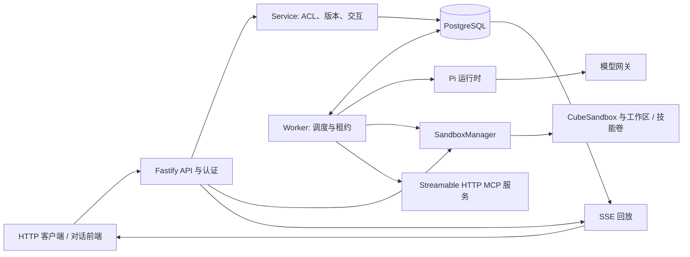

# Pi-Flow 架构

[English](architecture.md) · [README](../README.zh-CN.md)

本文描述当前 `work` 分支架构。详细回归记录见 [实现说明](implementation.md)，生产验证证据与发布门禁见 [验收要求](acceptance.md)。

## 组件



生产模式通常分别运行 API 和 Worker，共享数据库。Demo 在 API 内运行 Worker，使用模拟运行时和内存 Sandbox Provider。生产模式也可通过 `INLINE_WORKER=true` 启用进程内 Worker。

| 模块 | 职责 |
| --- | --- |
| `src/api.ts`、`src/auth.ts` | REST/SSE、输入校验、UCS OIDC、请求审计 |
| `src/domain.ts`、`src/service.ts` | ACL、不可变智能体版本、幂等、交互 |
| `src/store.ts`、`src/run-store.ts` | 元数据事务、Session、Run、事件、读取投影 |
| `src/worker.ts` | 租户调度、领取、心跳、取消、工具策略、子任务 |
| `src/runtime.ts` | Pi 会话、受控资源加载、模型调用 |
| `src/adapters/sandbox.ts`、`src/sandbox/*` | Sandbox 编排、Provider、租约、有界远程调用 |
| `src/adapters/sandbox-policy.ts`、`src/capacity-store.ts` | 共享容量预留与操作代次校验 |
| `src/adapters/mcp.ts` | MCP 发现、白名单、凭证、有界调用 |
| `src/usage.ts`、`src/telemetry.ts`、`src/health.ts` | 预算账本、费用估算、遥测、健康检查 |

Provider 与 Manager 的划分见 [Sandbox 模块边界](sandbox-modules.md)。

## 数据与并发

Tenant 拥有其智能体、工作区、会话、Run、审计和用量记录。Workspace 以 owner/editor/viewer 控制访问。Session 绑定稳定的逻辑 Agent，并记录最近生效的 AgentVersion。每个独立 root task 在提交事务中解析 activeVersionId、校验能力和 Workspace 兼容性，再更新 Session 的 effectiveVersionId（agentVersionId 为兼容别名）。Run 锁定 agentVersionId、能力快照、taskId 和 rootRunId；审批/提问续跑与子任务继承任务身份，不读取 Session 的可变有效版本来执行。子智能体引用不可变版本 ID，能力取父子交集。

PostgreSQL 将会话、Run、事件与序列持久化到 `harness_sessions`、`harness_runs`、`harness_run_events` 和 `harness_event_sequences`；容量记录位于 `harness_sandbox_leases`。租户元数据与用量账本仍采用 JSONB 聚合；旧版将全部 Run 和容量写入聚合 JSONB 的方式已不是当前存储设计。

- Session 部分唯一索引保证 `QUEUED`、`RUNNING`、`WAITING_INPUT` Run 互斥。幂等键作用域为 Tenant + User + Session + Key。
- Run 领取、心跳和结束检查持久租约归属与有效期；普通跨实体写事务仍保留租户元数据锁。
- 容量准入使用全局事务 advisory lock 和索引计数。`reserved`、`unknown` 仍占用配额；状态转换比较持久操作标识。
- 容量预留后若授权检查失败，尚未发起实例操作且没有未完成创建请求的预留会恢复原容量状态，新工作区则转为 `released`。回滚保留新的操作标识以隔离旧回调，不能覆盖后继租约。仅完成 Volume 创建不会保留 Sandbox 配额。实例操作已经发起时，激活前的授权失败走确认清理；无法确认的结果仍标记 `unknown` 并占用配额。
- 不同会话可并行推理。同工作区并发的智能体工具（包括只读的 `read`、`ls`、`grep`、`find`）会透明等待持久化工作区租约，并排他执行。等待者通过不加锁的只读查询观察工作区与技能元数据，不加载 Run、Session 或事件历史。仅当租约可能空闲时才进入写事务，在事务内重新检查锁与权限，因此共享 PostgreSQL 的不同 Run 和 Worker 进程也会串行执行；不保证先进先出。写工具（`write`、`edit`、`bash`）重新检查工作区写权限，Worker 调用在获取租约和执行前重新检查当前 Run 的租约所有权、截止时间和授权。等待响应 Run 的取消和截止时间，默认最多 130 秒（超时返回 `WORKSPACE_QUEUE_TIMEOUT`）；等待期间不占用容量、不操作当前沙箱。已有的生命周期锁或文件写入锁仍返回 `WORKSPACE_BUSY`，生命周期操作和文件写入也仍会拒绝占有智能体租约的工作区。文件读取使用独立临时实例，可与智能体工具并行。

这些约束保证正确性，也仍存在锁竞争边界。详见 [Run 迁移](run-migration.md)、[容量迁移](capacity-migration.md) 和 [用量预算](usage-budgets.md)。

## 执行与交互

```text
提交消息 → QUEUED → Worker 领取 → RUNNING
                                    ├─ COMPLETED / FAILED / CANCELLED
                                    └─ WAITING_INPUT
                                         └─ 用户响应 → 新的 QUEUED Run
```

Worker 轮询租户，加载已授权执行上下文，并以显式工具集合调用 Pi。完成消息和会话检查点写入数据库。审批保存已校验的工具参数；续跑重新检查权限后执行获批操作，拒绝则跳过执行。

子智能体使用独立会话、父子权限交集和根任务共享预算。目前顺序执行；子任务需要审批或问答时安全失败并返回父智能体。

Worker 失租后，不确定 Run 以 `FAILED` 结束，不重新入队。未知远程副作用不会自动重试或重放。取消传递到运行时与远程操作；清理未确认时明确报错并保留容量占用。

## 事件与客户端

Worker 先持久化事件，再由 SSE 发送。消息片段批量写入，回放使用每页最多 100 条的索引查询、PostgreSQL 通知和有界轮询。通知用于唤醒读取，持久日志是回放来源。客户端使用最后收到的事件 ID 重连。

Run 进入终态或 `WAITING_INPUT` 时结束 SSE。交互响应返回新 Run ID。令牌到期时以 `AUTHENTICATION_EXPIRED` 关闭流，客户端携带新认证头重连；事件页读取重新检查工作区 ACL。详见 [事件流](event-streaming.md) 和 [API](api.md)。

## 执行与安全边界

Pi ResourceLoader 禁用本地技能、扩展自动发现和默认本地文件/Shell 工具。Worker 显式提供远程工具及构建期交互工具。生产文件和 Shell 操作在 CubeSandbox 内执行，不向 Sandbox 注入 UCS、模型或 MCP 凭证。

每个工作区挂载独立可写 `/workspace` 卷。`SKILL_VOLUMES_JSON` 将选定技能版本绑定到独立只读卷及清单路径，Bundle 是租户权限分组。工具访问校验清单身份与 SHA-256；授权技能集合变化时，先确认旧实例销毁，再保留工作区卷重建实例。

文件 API 使用仅挂载工作区卷的临时实例，计入 owner/全局容量，并需确认清理。默认每租户内工作区 owner 最多 3 个活跃实例，部署全局最多 100 个；空闲 15 分钟暂停、24 小时释放，由 Worker 每分钟扫描。

MCP 仅发现智能体指定的服务，调用前再次检查白名单、Endpoint 身份与撤销。发现继承取消信号和 Run 剩余时间，总预算最多 30 秒。服务访问使用部署凭证，用户委托 OAuth 尚未提供。

实际非 root 身份、卷隔离、资源限制和网络策略由 Cube 强制执行。入站流量配置不代表出口隔离。实例快照恢复保留当前工作区文件，不能替代卷或数据库备份；Cube 跨工作区克隆被拒绝。

## 运维与限制

API readiness 检查数据库与 schema，Worker 健康独立判断。全部 API/Worker 必须使用一致的租户授权、模型、卷映射、容量策略与价格。迁移前停止旧写入者并备份，禁止新旧存储写入者混跑。

本地与协议测试不能证明企业 Cube 隔离、供应商账单精确性或生产容量。费用报表基于记录用量和价格快照进行估算。历史保留与剩余 JSONB 增长需部署策略。详见 [部署](deployment.md)、[健康检查](health.md)、[可观测性](observability.md) 和 [验收要求](acceptance.md)。

## 任务版本与升级

发布后只更新逻辑 Agent 的 activeVersionId，不扫描 Session，不禁用旧版本。已有 QUEUED、RUNNING、WAITING_INPUT Run 保留版本；新任务惰性升级，保留 Session ID、entries、Todo 和 Workspace Volume。幂等重试返回原 Run，不重新解析最新版。整个任务链有未结束子任务时，原 Session 仍返回 SESSION_BUSY。升级记录 session.version.upgraded 事件及审计，包含 from/to、时间、actor/reason。紧急撤销仍通过版本 status/access、Skills/MCP 注册状态和租户授权动态阻断。

Sandbox 生命周期独立于版本。pause/release 不更新 Session；等待期间恢复交互仍使用旧版本。同 bundle、同 scope 复用 ACTIVE/PAUSED Sandbox；scope 改变时由 Workspace 独占工具租约保护重建并保留 Volume，RELEASED 时按锁定配置创建。共享 Workspace 有不兼容未结束任务时，新任务返回 WORKSPACE_VERSION_BUSY，等待任务结束后重试；工具或生命周期租约占用时返回 WORKSPACE_BUSY。跨 bundle 不自动迁移，返回 WORKSPACE_BUNDLE_MIGRATION_REQUIRED，需创建匹配 bundle 的 Workspace。

部署前停止旧写入者并执行 migrations/005_agent_task_versions.sql：每个历史版本成为独立逻辑 Agent，旧 Session 补齐 agentId/effectiveVersionId，历史 Run 从原 Session 补齐版本/能力并沿 parentRunId 和交互 resumedFrom 重建任务链。配置、历史和 Volume 不改变；管理员可针对迁移后的逻辑 Agent 发布后续版本。详见 [版本迁移](agent-version-migration.md)。

allowedUsers 是逻辑 Agent 的动态策略，发布和回滚只改变执行版本、不改变权限；查询历史版本和执行旧任务同样按逻辑策略授权。Migration 006 从当前生效版本迁移 ACL。Workspace 的逻辑技能 scope 与 Provider 的物理挂载 scope 分别记录：前者用于提交兼容性校验，后者用于租约内执行环境复用判断。显式 Resume 只恢复生命周期；若旧技能选择已撤销则重建为无技能环境并保留 Volume，不选择最新版本或升级 Session。新任务随后按其锁定配置适配环境，旧等待任务仍受动态撤销检查。

新 root task 提交时，对同 Workspace 中已完成 checkpoint 的撤销等待任务执行任务链失效，并记录失败原因和审计；JWT 过期本身不失效。历史技能身份计算与实时授权分开，未撤销等待任务的兼容性约束保留。取消任何 Run 时按 taskId 取消完整任务链，覆盖已完成原 Run 之后的审批续跑；实际执行和租约仍按现有停止机制安全收敛。
